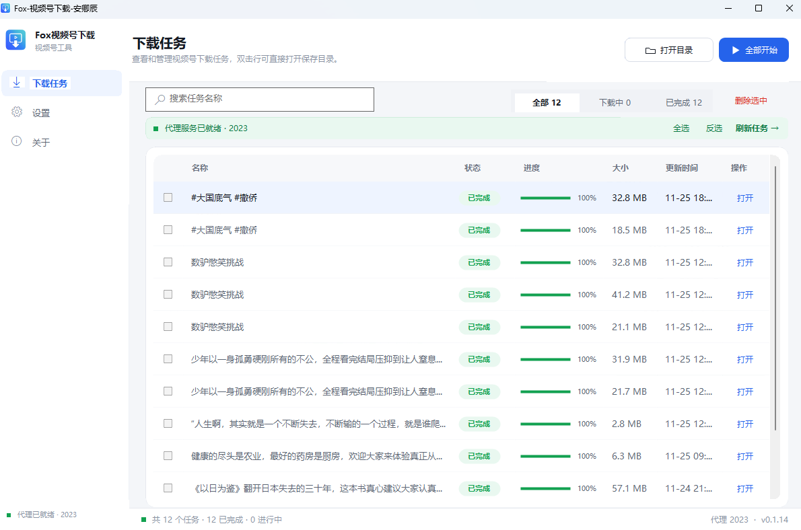
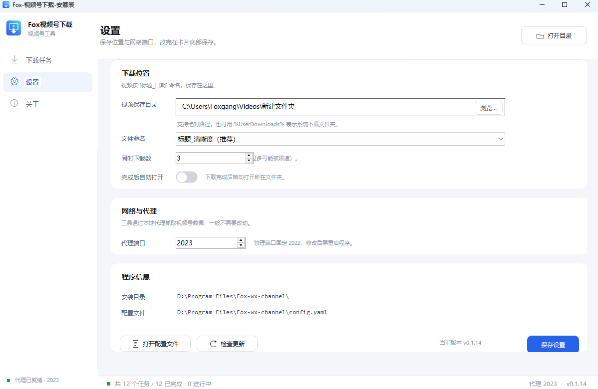
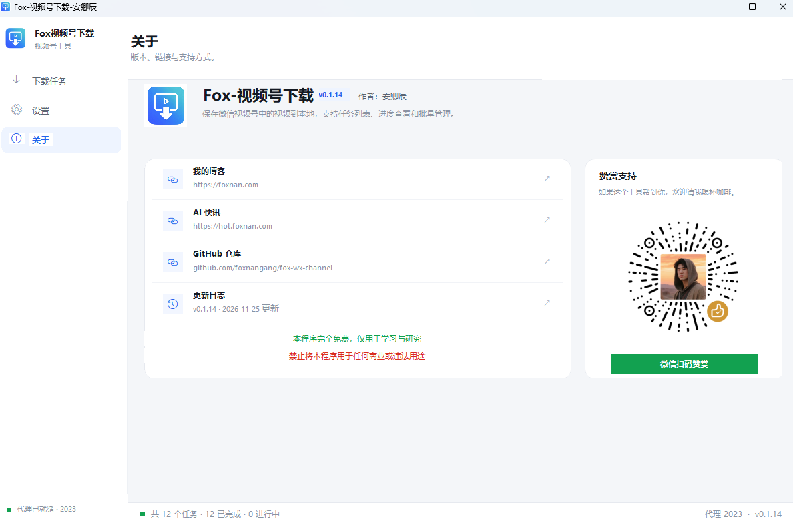

# Fox 视频号下载 · 微信视频号下载工具


一款 Windows 桌面工具，用于把微信视频号里正在浏览的视频保存到本地。  
原生窗口界面，不依赖浏览器套壳，支持任务列表、进度查看、批量操作和本地保存目录设置。



## 功能亮点

- 保存微信视频号中的视频到本地
- 原生 Windows 程序，无浏览器套壳、无控制台窗口
- 任务列表展示名称、状态、进度、大小、更新时间
- 支持批量开始/暂停、删除任务、搜索任务
- 双击任务行可直接打开保存目录
- 下载清晰度按分辨率/码率排序，最高项会明确标注
- 支持修改视频保存目录、文件命名规则、并发下载数
- 支持下载完成后自动打开所在文件夹
- 内置自动更新，可手动检查更新并显示下载进度
- 标准安装向导，自动创建桌面和开始菜单快捷方式
- 提供卸载程序，可从 Windows“应用”中卸载

## 界面预览

### 下载任务


### 设置页



### 关于页



## 系统要求

| 项目 | 要求 |
|---|---|
| 系统 | Windows 10 / Windows 11，x86_64 |
| 微信 | 微信 PC 4.x |
| 运行时 | Microsoft .NET 9 桌面运行时 |
| 权限 | 首次运行可能需要管理员授权 |

## 下载与安装

1. 打开 [Releases](https://github.com/foxnangang/fox-wx-channel/releases)。
2. 下载 `Fox-wx-channel-Setup.exe`。
3. 以管理员身份运行安装包。
4. 选择安装目录。默认安装到 `%LOCALAPPDATA%\微信视频号下载工具`。
5. 如果选择 `Program Files` 或盘符根目录，安装程序会自动创建 `微信视频号下载工具` 子文件夹。
6. 点击“安装”，完成后可直接运行程序或打开安装目录。

如果安装程序检测到旧版本，会弹出选择：

- **覆盖安装**：安装到原目录，保留已有 `config.yaml` 和任务数据。
- **全新安装**：安装到新目录，旧版本文件不会自动删除。
- **取消**：退出安装。

覆盖安装不会覆盖已有的 `config.yaml`。

## 使用流程

1. 打开程序，后台服务会自动启动。
2. 首次运行可能弹出管理员授权，用于安装本机根证书和设置系统代理。
3. 打开微信 PC 端视频号。
4. 播放视频后暂停，点击页面上的下载按钮；无按钮时查看页面侧边或底部悬浮按钮。
5. 回到程序，在“下载任务”中查看进度和保存位置。
6. 双击任务行可以打开该任务所在的保存目录。

## 设置说明

| 设置项 | 说明 |
|---|---|
| 视频保存目录 | 支持绝对路径，也支持 `%UserDownloads%` 表示系统下载文件夹 |
| 文件命名 | 支持 `标题_清晰度`、仅标题、`标题_日期` |
| 同时下载数 | 最多 10，过多可能被限速 |
| 完成后自动打开 | 下载完成后自动打开所在文件夹 |
| 代理端口 | 默认 `2023`，管理端口固定为 `2022` |
| 检查更新 | 可手动检查更新，自动更新会显示下载进度 |

修改设置后需要重启程序生效。设置页也可以直接打开配置文件和安装目录。

## 自动更新

- 程序启动时会自动检查新版本。
- 也可以在“设置 → 程序信息 → 检查更新”手动检查。
- 更新下载时会显示进度窗口。
- 更新包会校验 SHA256，通过后静默覆盖安装并重启程序。
- 更新会保留现有配置和任务数据。

## 常见问题

### 视频号页面没有下载按钮

微信 4.2.x 需要将视频号配置中的 `featureSwitch.handleFinder` 改为 `false`。  
操作前请完全退出微信并备份文件：

```text
%APPDATA%\Tencent\xwechat\radium\users\<账号ID>\xworker\liteapp\local\packages\ilinkres_uzhblidb\engineConfig\<版本>\dist\engineConfig.json
```

保存后重新打开微信。

### 任务列表为空

确认后台服务已启动，并点击“刷新”。  
如果保存目录发生过变化，新任务会写入新目录，旧文件不会自动移动。

### 首次运行弹出管理员授权

安装本机根证书和设置系统代理需要管理员权限，属于正常现象。

### 任务下载失败

检查视频是否仍可播放、网络是否正常，以及保存目录是否可写。  
必要时删除任务后重新下载。

### 关闭窗口后后台还在运行

关闭主窗口会停止由它启动的后台服务。  
如果后台服务是由其他方式启动的，请从任务管理器结束 `fox-wx-channel-core.exe`。

## 安全说明

- 根证书私钥只保存在本机安装目录，请勿分享。
- 程序只在本机运行本地服务，管理端口为 `127.0.0.1:2022`。
- 建议从本仓库 Releases 下载安装包，不要使用来源不明的修改版。

## 免责声明

本程序完全免费，仅供学习与研究。  
禁止将本程序用于任何商业用途或违法用途。  
请勿用于下载、传播受版权保护且未经授权的内容。

## 链接

- 作者：安卿辰
- 我的博客：<https://foxnan.com>
- AI 快讯：<https://hot.foxnan.com>
- 发行版：<https://github.com/foxnangang/fox-wx-channel/releases>

## 许可证

许可证文件随程序安装在安装目录中，详见 [LICENSE](LICENSE)。
